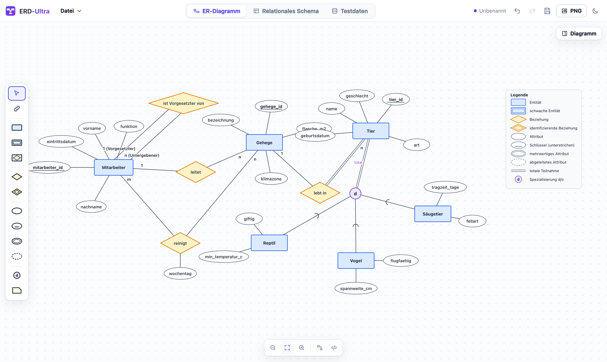
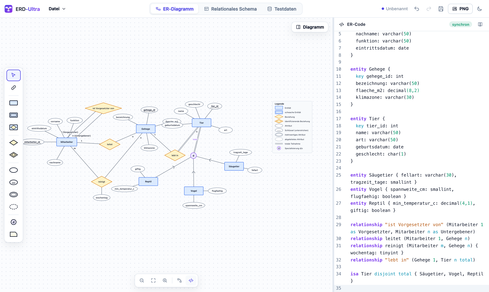
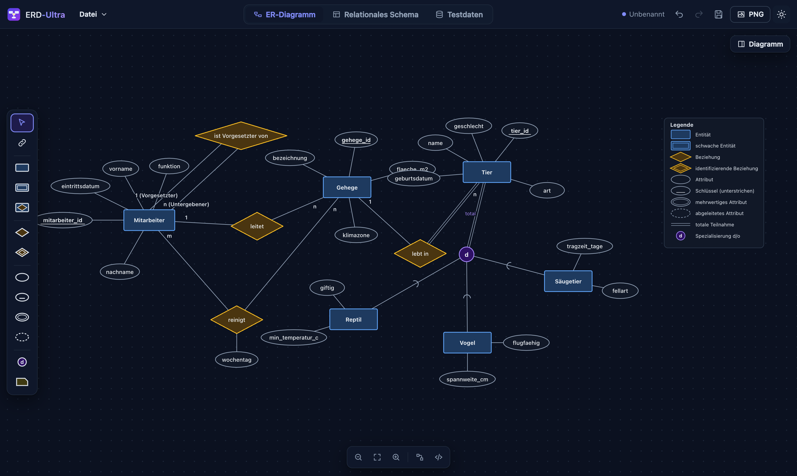
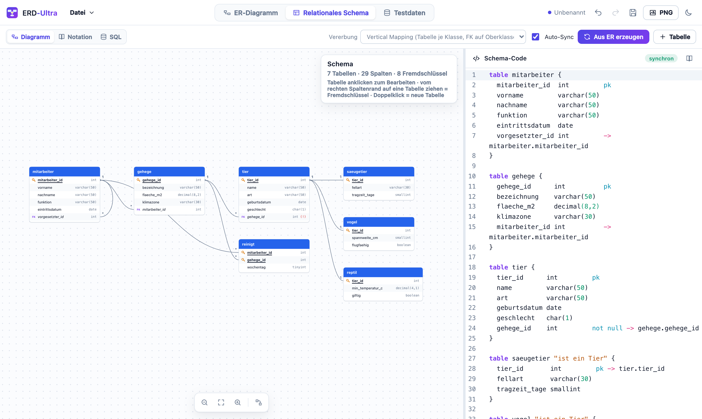
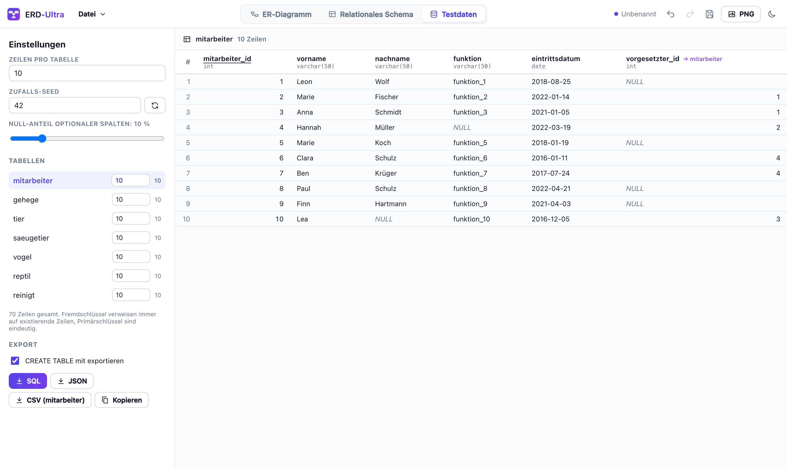

# ERD-Ultra

ERD-Ultra ist eine Desktop-App für **macOS, Linux und Windows 11**. Damit erstellst du ER-Diagramme in Chen-Notation und relationale Schemas, grafisch oder per Code, und erzeugst passende Testdaten.



## Funktionen

**ER-Diagramme (Chen-Notation)**
- Grafischer Editor mit Werkzeugleiste, Drag & Drop, Verbinden per Ziehen, Mehrfachauswahl, Kopieren/Einfügen, Rückgängig/Wiederholen und automatischem Layout
- Code-Editor (ER-DSL) mit Syntaxhervorhebung und Fehlermarkierung, beide Ansichten bleiben synchron
- Alle Konstrukte:
  - Entitäten, **schwache Entitäten** und **identifizierende Beziehungen**
  - Aggregation / assoziative Entitäten
  - Attribute: einfach, **Schlüssel**, Teilschlüssel, **mehrwertig**, **abgeleitet**, **zusammengesetzt**
  - Beziehungen: binär, **rekursiv mit Rollen**, **n-är**, mit eigenen Attributen
  - Kardinalitäten in **1 / n / m** und in **(min,max)**-Notation
  - **totale/partielle Teilnahme** (Doppellinie)
  - **Generalisierung / Spezialisierung**: disjunkt (d) oder überlappend (o), total oder partiell
  - Notizen und Legende
- Export als **PNG** (hochaufgelöst) und **SVG**, Speichern im eigenen Format **`.erdu`**



Auch im dunklen Design:



**Relationale Schemas**
- Automatische Abbildung ER → Relational mit wählbarer Vererbungs-Strategie:
  - Vertical Mapping
  - Horizontal Mapping
  - Table per Sub-Entity-Type
  - Single Table
- Grafischer Editor im Stil von dbdiagram.io: Tabellen, Spalten, PK, NOT NULL, UNIQUE und Fremdschlüssel per Ziehen
- Code-Editor (an DBML angelehnt), Lehrbuch-Notation `tier(tier_id, name, ↑gehege_id)`, SQL-DDL für PostgreSQL, MySQL, SQLite und SQL Server



**Testdaten**
- Realistische deutsche Testdaten, die zu Spaltennamen und Typen passen (Namen, Orte, Datumswerte, Gehälter, …)
- Eindeutige Primärschlüssel, gültige Fremdschlüssel, wählbarer NULL-Anteil und reproduzierbarer Seed
- Export als SQL (`INSERT`, optional mit `CREATE TABLE`), CSV oder JSON



## ER-Code (Beispiel)

```
entity Mitarbeiter {
  key mitarbeiter_id: int
  name
  multi telefon
  derived alter
  adresse { strasse, plz, ort }
}
entity Gehege { key gehege_id: int, bezeichnung }
entity Tier { key tier_id: int, name }
entity Vogel { spannweite_cm: int }
entity Reptil { giftig: boolean }
weak entity Futterplan { partial nr: int }

relationship "ist Vorgesetzter von" (Mitarbeiter 1 as Vorgesetzter, Mitarbeiter n as Untergebener)
relationship reinigt (Mitarbeiter m, Gehege n) { wochentag }
relationship "lebt in" (Gehege 1, Tier n total)
identifying relationship hat (Tier 1, Futterplan n total)
relationship liefert (Lieferant (0,n), Teil (1,n), Projekt (0,n))

isa Tier disjoint total { Vogel, Reptil }
associative entity Belegung (Student n, Kurs m) { note }
```

## Relationen-Code (Beispiel)

```
table mitarbeiter {
  id      int pk
  name    varchar(100) not null
  chef_id int -> mitarbeiter.id
}
```

## Tastenkürzel

| Kürzel | Aktion |
| --- | --- |
| ⌘/Strg + S / ⇧⌘S | Speichern / Speichern unter |
| ⌘/Strg + O / N | Öffnen / Neu |
| ⌘/Strg + Z / ⇧Z | Rückgängig / Wiederholen |
| ⇧⌘/Strg + E | PNG exportieren |
| ⌘/Strg + 1 / 2 / 3 | ER / Schema / Testdaten |
| V C E W R A K M D I N | Werkzeuge |
| Entf, Pfeiltasten, ⌘C/⌘V/⌘D, F2 | Löschen, Verschieben, Kopieren/Einfügen/Duplizieren, Umbenennen |
| 0 | Alles anzeigen |

## JetBrains-Plugin

ERD-Ultra gibt es auch als Plugin für IntelliJ IDEA, PyCharm, DataGrip und die anderen JetBrains-IDEs (ab 2024.3).

- `.erdu`-Dateien öffnen sich im grafischen ERD-Ultra-Editor. Der JSON-Text bleibt als zweiter Reiter erreichbar, Speichern, Änderungsmarkierung, lokale Historie und Git laufen wie bei jeder anderen Datei.
- Das Tool-Fenster **ERD-Ultra** (rechts) enthält die komplette App.
- *Neu → ERD-Ultra-Diagramm* legt ein leeres Diagramm an.
- Zoomen per Scrollen (Mausrad/Trackpad) oder Pinch; verschieben per Ziehen der freien Fläche oder Shift + Rad.

Installation: `ERD-Ultra-JetBrains-Plugin-<version>.zip` aus dem Release laden, dann in der IDE *Einstellungen → Plugins → ⚙ → Plugin von Datenträger installieren…*.

Selbst bauen (JDK 21 wird bei Bedarf automatisch geladen):

```bash
cd jetbrains-plugin
./gradlew buildPlugin   # baut auch die Web-App, Ergebnis in build/distributions/
./gradlew runIde        # Test-IDE mit dem Plugin starten
```

## Entwicklung

Voraussetzungen: Node.js 22+, Rust (stable) und die [Tauri-Voraussetzungen](https://tauri.app/start/prerequisites/).

```bash
npm install
npm run app:dev     # Desktop-App im Entwicklungsmodus
npm run dev         # nur Weboberfläche im Browser
npm test            # Tests
npm run app:build   # Installer lokal bauen
```

## Releases und Versionierung

Bei jedem Push baut GitHub Actions die Installer und das JetBrains-Plugin und veröffentlicht sie als Release:

| Push auf | Ergebnis |
| --- | --- |
| `main` | stabile Version, z.B. `v1.4.2` |
| `release/*` | Release-Candidate, z.B. `v1.5.0-rc.1` |
| jeder andere Branch | Pre-Release, z.B. `v1.5.0-beta.3` |
| Tag `vX.Y.Z` | genau diese Version |

Die Desktop-App und das JetBrains-Plugin prüfen beim Start, ob auf GitHub eine neuere Version liegt, und bieten das Update an (*Aktualisieren*, *Später* oder *Überspringen*). Stabile Versionen melden nur stabile Releases, Beta- und RC-Versionen auch neuere Pre-Releases. Manuell geht das über *Datei → Nach Updates suchen…*.

Welcher Teil der Version steigt, richtet sich nach den Commit-Nachrichten ([Conventional Commits](https://www.conventionalcommits.org/de/)):

| Commit-Nachricht | Versionssprung |
| --- | --- |
| `fix: …`, `chore: …` und alle anderen | Patch (Bugfix-Version) |
| `feat: …` | Minor |
| `feat!: …` oder `BREAKING CHANGE` | Major |

`[skip release]` in der Commit-Nachricht überspringt den Build. Über „Run workflow“ in GitHub Actions kann man den Versionssprung auch manuell wählen.

Installer:

| System | Formate |
| --- | --- |
| macOS | Universal `.dmg` / `.app` für Apple Silicon und Intel |
| Windows 11 | `.msi` und `.exe` (NSIS) |
| Linux | `.AppImage`, `.deb` und `.rpm` |
| JetBrains-IDEs | `ERD-Ultra-JetBrains-Plugin-<version>.zip` |

> Die Installer sind nicht signiert. Unter macOS beim ersten Start Rechtsklick → „Öffnen“ wählen. Unter Windows bei SmartScreen auf „Weitere Informationen“ → „Trotzdem ausführen“ klicken.

## Lizenz

MIT
